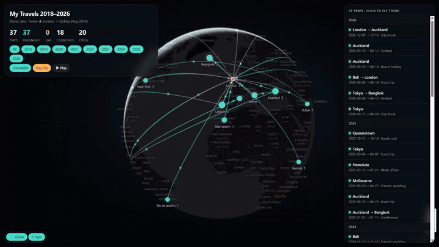

# WhatsApp Travel Globe 🌏

Count every trip you've ever taken using only your WhatsApp history, then see them on an interactive 3D globe.



**Live demo:** https://degenyang.github.io/whatsapp-travel-globe/ *(demo data: random cities, not real trips)*

- **Globe:** a single `globe.html` built on [MapLibre GL JS](https://github.com/maplibre/maplibre-gl-js) with free [OpenFreeMap](https://openfreemap.org) tiles. No API key, no server, no build step.
- **What it shows:**
  - great-circle flight arcs with animated "planes"
  - a pulsing home base, which can change over time (e.g. after a move)
  - year and overnight/day-trip filters with live stats
  - a ▶ Play mode that replays every trip in order
  - the countries you've been to, shaded, with your share of the world's 195
  - a timeline bar with one mark per trip
  - an **⤓ Image** button that saves a 1080×1350 picture of your map and stats, ready to post
  - links to a single trip, e.g. `globe.html#trip=2019-04-05-par`
  - keys: **P** play, **G** globe/flat, **R** spin, **S** image, **T** timeline, **← →** previous/next trip, **Esc** back
- **Pipeline:** a few small Python scripts plus a prompt you give to your AI agent to turn 5,000+ chats into a verified trip list.

> **Lazy mode:** give this repo to your AI agent (Claude Code, Codex, …) and say *"do this with my WhatsApp"*.

---

## Quick look

Open `globe.html` in a browser, or the [live demo](https://degenyang.github.io/whatsapp-travel-globe/). It loads `data/trips.example.js`, the demo data.

## Make your own

### 1. Get all your chats out of WhatsApp

The in-app *Export Chat* only does one chat at a time and caps the number of messages, so read the phone's database instead.

**Android (no root needed)**
1. WhatsApp → Settings → Chats → Chat backup → turn on **End-to-end encrypted backup** and choose **use a 64-digit encryption key**. Save the key somewhere safe.
2. Run a backup, then copy `Android/media/com.whatsapp/WhatsApp/Databases/msgstore.db.crypt15` to your PC.
3. Decrypt it to `msgstore.db` with either:
   - [KnugiHK/WhatsApp-Chat-Exporter](https://github.com/KnugiHK/WhatsApp-Chat-Exporter): `pip install "whatsapp-chat-exporter[crypt15]"`
   - [ElDavoo/wa-crypt-tools](https://github.com/ElDavoo/wa-crypt-tools)
4. Write one text file per chat:
   ```bash
   # optional: WA_TZ_HOURS=1 for UTC+1 (default 0 = UTC), WA_LOCAL_CC=44 for contacts saved without a country code
   python scripts/wa_stream_export.py msgstore.db chats/ contacts.csv
   ```
   `contacts.csv` is a Google Contacts export. It's optional and turns phone numbers into names.

**iPhone:** make a local (Finder / Apple Devices) backup and run WhatsApp-Chat-Exporter in iOS mode (`-i`) with `--txt`. The in-app *Export Chat* `.txt` files also work for a few chats.

### 2. Keyword sweep

```bash
python scripts/extract.py chats/ travel/ --partner "Name of the chat with your travel partner"
```

This keeps only your own messages plus your partner chat, filters them for travel words in English, and writes `travel/yYYYY.txt`. Add words for your language in `extract.py`.

It reads the usual export formats: Android (`05/04/2019, 14:30 - You: …`, also with `2:30 pm`), iPhone (`[05/04/2019, 14:30:12] Your Name: …`) and US (`4/5/19, 2:30 PM - You: …`). Messages that run over several lines are joined.
- Your own sender name is `You` on Android but your own name on iPhone. Pass `--me` once for each: `--me You --me "Your Name"`.
- Day/month order is guessed per file. If all your dates are ambiguous (no day above 12), force it with `--date-order mdy` or `--date-order dmy`.

Keywords alone are noisy ("check in", "visa", news about someone else landing). Expect several times more hits than real trips. That's what step 3 is for.

### 3. Let AI agents verify every trip

Give your agent `prompts/verify_trips.md`, filled in with your paths, years and home base. Run several agents in parallel, for example one per 3 years. Each agent:
- reads the yearly files
- checks the raw chat around each date
- returns a table of trips with an evidence quote for each one

**Check the maths yourself.** Agents are good at judging trips and bad at adding up their own tables.

**This step sends chat text to your AI provider.** See [Privacy](#privacy) before you run it.

### 4. Put the trips on the globe

Copy `data/trips.example.js` to `data/trips.js` and fill it in:

```js
window.TRIPS = {
  title: "My Travels 2018–2026",
  subtitle: "home ★ London → Sydney (Aug 2023)",
  homes: { LON: "Home until 2023-08", SYD: "Home since 2023-08" },
  places: { LON: ["London", 51.5072, -0.1276], PAR: ["Paris", 48.8566, 2.3522] /* … */ },
  country: { LON: "GB", PAR: "FR" /* … */ },   // ISO 3166 two-letter codes
  trips: [
    // start, end ("" = day trip), from, [stops…], note, "o" overnight | "d" day trip
    ["2019-04-05", "2019-04-08", "LON", ["PAR"], "City break", "o"],
  ],
};
```

`globe.html` uses `data/trips.js` when it exists and falls back to the demo otherwise. `data/trips.js` is git-ignored, so your real trips never get committed.

If a row has a mistake (an unknown place key, a date like `2019-13-05`, an end before the start), the page lists it in a red box and still shows every other trip.

## Privacy

Your chat database is your whole life.
- Keep it on your own machine.
- Don't upload it to "WhatsApp analyzer" websites.
- Never commit `msgstore.db`, chat exports, contacts or your `trips.js`.

The `.gitignore` here blocks the usual file names, but check `git status` before every push anyway.

**What leaves your machine in step 3.** Your AI agent sends what it reads to its provider (Anthropic, OpenAI, …): the yearly `travel/` files, plus the raw chat lines it greps around each date. Those lines can include other people's names and messages. To send less:
- Give the agent only the `travel/` folder and skip the raw-chat check. The result is less accurate.
- Check your provider's settings for data retention and model training, and use an account where your chats are not used for training.
- Or run a local model (for example with [Ollama](https://ollama.com)) so nothing leaves your PC. Expect weaker judgement than the large cloud models.

**Publishing your own globe.** If you host your globe (for example on GitHub Pages), your `trips.js` is public: dates, places and notes. Remove anything you would not post yourself, such as notes that name other people.

## Tests

```bash
python -m pytest tests                 # extract.py on sample chats in every export format
pip install playwright pillow
python tests/check_globe.py            # opens globe.html in headless Edge/Chrome and checks each feature
```

## Credits

- [MapLibre GL JS](https://github.com/maplibre/maplibre-gl-js) (BSD-3-Clause)
- [OpenFreeMap](https://openfreemap.org) tiles, © OpenMapTiles, data © OpenStreetMap contributors
- Country outlines: [Natural Earth](https://www.naturalearthdata.com) (public domain)
- [WhatsApp-Chat-Exporter](https://github.com/KnugiHK/WhatsApp-Chat-Exporter), [wa-crypt-tools](https://github.com/ElDavoo/wa-crypt-tools)

MIT licensed. See [LICENSE](LICENSE).
